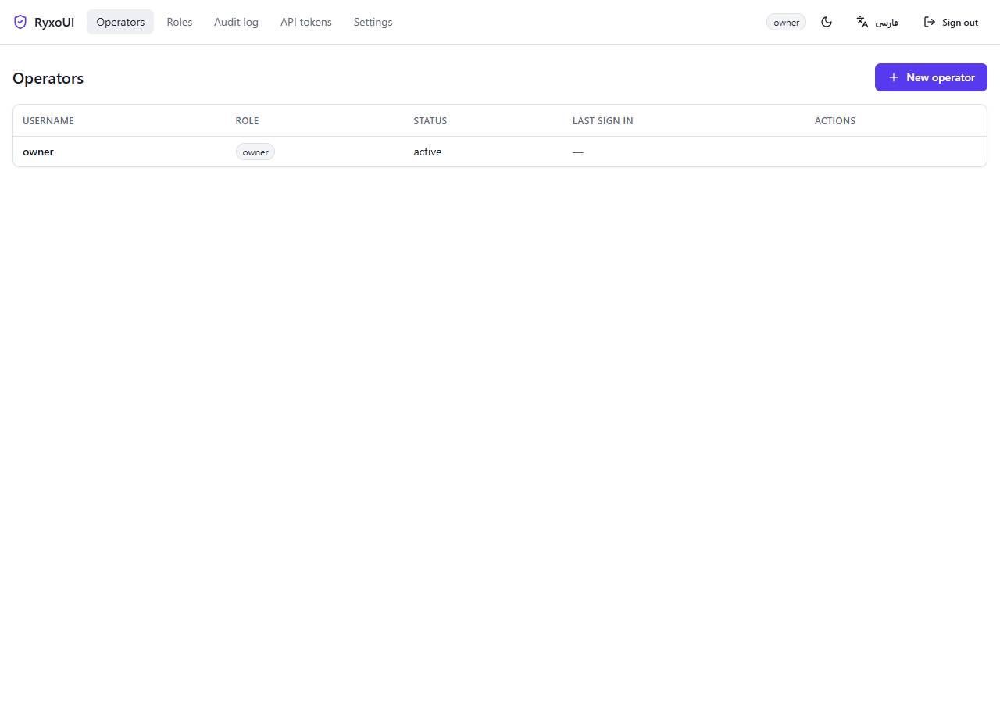
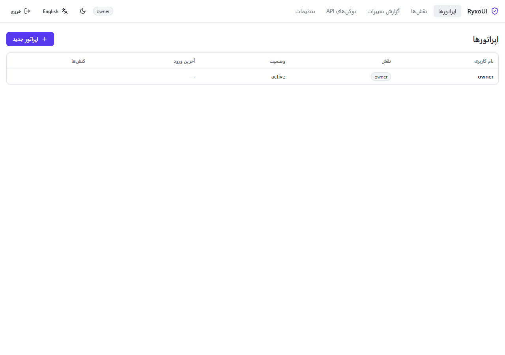

# RyxoUI

[](https://github.com/itzsepanta/RyxoUI/actions/workflows/build.yml)
[](https://github.com/itzsepanta/RyxoUI/actions/workflows/release.yml)
[](LICENSE)
[](https://go.dev)
[](https://react.dev)

**Self hosted, multi protocol VPN control panel.**

RyxoUI is a single Go binary that owns the whole life cycle of a node:
registration over SSH, protocol engines, user accounts, quotas, statistics,
subscription portals and the management interface itself.

The panel is independent software. No code, text, appearance or branding is
taken from any other project; the only reference used during design was the
publicly observable *capability surface* of comparable panels.



> The interface speaks English and Persian and switches to a right to left
> layout automatically.
> 

---

## Features

| Area | What it does today |
| --- | --- |
| Storage | SQLite and Postgres behind one schema, versioned migrations, drift detection |
| Accounts | Argon2id passwords, session cookies, API tokens, TOTP with recovery codes |
| Access control | 37 scopes in 14 groups, three builtin roles, custom roles with inheritance |
| Audit | every change is logged inside the same transaction as the change |
| Events | durable outbox, retry with backoff, delivery records, 9 event types |
| Nodes | registry, SSH access, health samples, traffic, install over SSH |
| Installer | a script that hands a fresh machine to the panel, the CA of the panel |
| Engines | one contract for every protocol, the xray adapter and its conformance suite |
| API | 22 endpoints, generated OpenAPI document, consistent error envelope |
| Self update | finds new releases, verifies the checksum, replaces the running binary |
| Interface | React 18, TypeScript, Vite, Tailwind, English and Persian, light and dark |

The full roadmap lives in [docs/roadmap.md](docs/roadmap.md).

## Install

### Container

```bash
docker run -d --name ryxoui \
  -p 8080:8080 \
  -v ryxoui-data:/var/lib/ryxoui \
  ghcr.io/itzsepanta/ryxoui:latest
```

### Binary

```bash
# Linux
curl -fsSL https://github.com/itzsepanta/RyxoUI/releases/latest/download/ryxoui_$(curl -fsSL https://api.github.com/repos/itzsepanta/RyxoUI/releases/latest | grep -o '"tag_name": *"[^"]*"' | cut -d'"' -f4 | tr -d v)_linux_amd64.tar.gz | tar xz
sudo install -m 0755 ryxoui /usr/local/bin/ryxoui
```

### From source

```bash
git clone https://github.com/itzsepanta/RyxoUI.git
cd RyxoUI

# the frontend is embedded into the binary
cd web && npm ci && npm run build && cd ..

go build -o bin/ryxoui ./cmd/ryxoui
```

## Run

```bash
ryxoui serve --listen 127.0.0.1:8080 --db ryxoui.db
```

Open `http://127.0.0.1:8080` and create the owner account. That account holds
every scope; create further operators with narrower roles from the
**Operators** screen.

### Commands

| Command | Purpose |
| --- | --- |
| `ryxoui serve` | start the panel |
| `ryxoui migrate` | apply the database schema |
| `ryxoui update` | check for and install a newer release |
| `ryxoui version` | print the version |

### Serve flags

| Flag | Default | Purpose |
| --- | --- | --- |
| `--listen` | `127.0.0.1:8080` | address to listen on |
| `--db` | `ryxoui.db` | database path or connection string |
| `--driver` | `sqlite` | `sqlite` or `postgres` |
| `--basepath` | empty | prefix for every route |
| `--tls` | `none` | `none` or `auto` |
| `--cert-file`, `--key-file` | empty | certificate for `auto` |
| `--log-level` | `info` | `debug`, `info`, `warn` or `error` |

## Installing a node

A fresh machine can hand itself to the panel with one command. The script
registers the machine, gives the panel its own key and confirms that the key
works. The token needs the scope `nodes:write` and is made on the **API
tokens** screen.

```bash
curl -fsSL https://panel.example/install/ryxoui.sh | sh -s -- \
  --panel https://panel.example --name eu-1 --address 10.0.0.5 --token <token>
```

The panel serves the script, its certificate authority and the binary of the
panel under `/install/`.

## Auto update

The panel can update itself from the releases of this repository.

- It checks the release feed every six hours and remembers the result.
- The **Updates** screen shows the running version, the newest release, the
  artefact for the current platform and the release notes.
- Installing a release downloads the artefact and verifies its SHA-256
  checksum against the `.sha256` file published next to it. A release
  without a checksum, or with a mismatching checksum, is never installed.
- The running binary is renamed rather than overwritten, so the replacement
  works on Linux and on Windows. The previous binary is kept as
  `ryxoui.old`.
- With `--service ryxoui.service` the panel restarts itself after the
  install.

```bash
ryxoui update --repo itzsepanta/RyxoUI            # report the newest release
ryxoui update --repo itzsepanta/RyxoUI --apply    # install it
```

Updating the panel needs the `panel:update` scope, which only the owner role
holds by default.

## API

Everything lives under `/api` and authenticates with the session cookie or
with an `Authorization: Bearer <token>` header.

```bash
curl -c cookies -X POST http://127.0.0.1:8080/api/login \
  -H 'Content-Type: application/json' \
  -d '{"username":"owner","password":"your password"}'

curl -b cookies http://127.0.0.1:8080/api/operators
```

The machine readable description is served at `/api/openapi.json` and
`/api/openapi.yaml`.

## Development

```bash
make test        # unit and integration tests
make race        # the same tests with the race detector
make vet         # go vet
make lint        # gofmt check
make web         # rebuild the frontend
make build       # build the binary
```

Run the panel locally with the Vite dev server:

```bash
ryxoui serve --db ryxoui.db      # terminal 1
cd web && npm run dev            # terminal 2, proxies /api to :8080
```

## Layout

```
cmd/ryxoui        command line entry point
internal/db       storage, dialect and migrations
internal/auth     passwords, sessions, API tokens, TOTP
internal/authz    scopes, roles and permission checks
internal/audit    the audit log
internal/events   event catalogue, outbox and dispatcher
internal/nodes    node registry, configuration, health, install jobs
internal/ssh      SSH client, key pairs, host key pinning
internal/engines  the protocol contract and its adapters
internal/certs    the certificate authority of the panel
internal/installer the script that hands a machine to the panel
internal/update   self update capability
internal/api      HTTP API, route table and OpenAPI generation
internal/web      embedded frontend assets
web               frontend sources (React, TypeScript, Vite, Tailwind)
docs              architecture, roadmap and the milestone plans
```

## Documentation

- [docs/architecture.md](docs/architecture.md) — how the layers fit together
- [docs/roadmap.md](docs/roadmap.md) — the capability roadmap, M0 to R
- [docs/milestone-m0.md](docs/milestone-m0.md) — the plan of the current milestone

## Contributing

See [CONTRIBUTING.md](CONTRIBUTING.md). Security reports go to the maintainers
privately, see [SECURITY.md](SECURITY.md).

## License

MIT, see [LICENSE](LICENSE).
